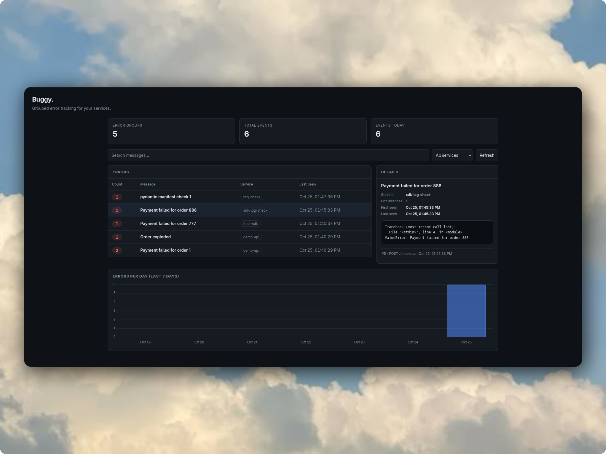

# Buggy

A tiny, self-hosted error tracker with a lightweight Python SDK, a FastAPI ingestion API, SQLite storage, and a zero-build dashboard. Buggy groups duplicate errors by fingerprint so you can inspect recurring failures and their stack traces in one place.



## Features

- **Automatic error grouping:** Similar errors share a fingerprint and appear as one group with an event count.
- **Python SDK:** Capture exceptions from your application with a small integration.
- **Event details:** Inspect captured metadata and stack traces for individual events.
- **Dashboard:** Search error messages, filter by service, review statistics, and inspect recent activity.
- **HTTP API:** Ingest events and query error groups and statistics.
- **Lightweight stack:** FastAPI, SQLite, and a frontend that does not require a separate build step.
- **Docker Compose:** Run the API, dashboard, and demo application together.

## Architecture

```text
┌────────────────────┐    POST /api/events    ┌────────────────────┐
│ Demo application   │ ─────────────────────► │ Buggy API :8000     │
│ :8001               │                        │ FastAPI             │
│ Python SDK          │                        └──────────┬─────────┘
└────────────────────┘                                   │ sqlite3
                                              ┌──────────▼─────────┐
                                              │ SQLite database     │
                                              │ buggy.db             │
                                              └──────────┬─────────┘
                                                         │ GET /api/*
┌────────────────────┐            GET /        ┌─────────▼──────────┐
│ Browser            │ ◄────────────────────── │ Dashboard           │
└────────────────────┘                          └────────────────────┘
```

## Quickstart

### Requirements

- Docker
- Docker Compose

### Run Buggy

From the repository root, run:

```bash
docker compose up --build
```

Once the containers are running, open:

| Service | URL |
|---|---|
| Dashboard and API | <http://localhost:8000> |
| Demo application | <http://localhost:8001/ok> |
| Interactive API documentation | <http://localhost:8000/docs> |

The database is stored in the `buggy_data` Docker volume, so data persists across container restarts. To stop the containers:

```bash
docker compose down
```

To stop the containers **and delete the persisted volume data**:

```bash
docker compose down -v
```

## Try the demo

The demo application includes routes that intentionally fail. Each failing request returns an HTTP `500` response and is reported to Buggy.

### 1. Generate duplicate errors

```bash
curl -i http://localhost:8001/user-fail/1
curl -i http://localhost:8001/user-fail/2
```

These requests simulate different users encountering the same error shape. Buggy should group them together and increment the group's event count.

### 2. Generate a different error

```bash
curl -i 'http://localhost:8001/fail?msg=Order%20exploded'
```

This message should appear as a separate error group if its fingerprint differs from the previous error.

### 3. Inspect the results

```bash
curl -s http://localhost:8000/api/errors
curl -s http://localhost:8000/api/stats
```

You can also open <http://localhost:8000> and select the `Payment failed for order` row to inspect its events and stack traces.

## Use the Python SDK

Import the SDK and initialize it with your Buggy ingestion endpoint and service name:

```python
from sdk.buggy import init, capture_exception

init(
    dsn="http://localhost:8000/api/events",
    service="demo-api",
)

try:
    checkout()
except Exception as exc:
    capture_exception(
        exc,
        route="POST /checkout",
        user_id="u_42",
    )
```

### Optional helpers

The SDK also provides a decorator and an uncaught-exception hook:

```python
from sdk.buggy import handle_exception, install_excepthook

@handle_exception(route="POST /checkout")
def checkout():
    ...

install_excepthook()
```

The SDK depends on `requests` and the Python standard library. Reporting is designed not to interrupt the application: if the Buggy server is unavailable or slow, the SDK returns `None` rather than raising an additional exception.

## API reference

| Method | Endpoint | Description |
|---|---|---|
| `POST` | `/api/events` | Ingest an event; responds with `202` and the fingerprint/count information. |
| `GET` | `/api/errors?search=&service=&limit=50` | List error groups, newest first, with optional search, service, and limit filters. |
| `GET` | `/api/errors/{fingerprint}?events_limit=20` | Retrieve one error group and its latest raw events; returns `404` if the group is unknown. |
| `GET` | `/api/stats` | Return `total_groups`, `total_events`, and `events_today`. |
| `GET` | `/health` | Return the service health status. |
| `GET` | `/` | Serve the dashboard. |
| `GET` | `/docs` | Open the interactive OpenAPI documentation. |

Invalid event payloads are rejected with HTTP `422` rather than being treated as internal server errors.

## Dashboard

The dashboard includes:

- Summary cards for error groups, total events, and events today
- Debounced message search and service filtering
- An error table showing count, message, service, and last-seen time
- A detail drawer with event metadata and stack traces
- A Chart.js bar chart showing activity over the last seven days

## Design choices

- **SQLite:** Keeps storage simple and self-contained for a small, self-hosted tool.
- **Fingerprint-based grouping:** Helps distinguish recurring error patterns from individual event occurrences.
- **FastAPI:** Provides a lightweight API and interactive OpenAPI documentation.
- **No frontend build step:** Makes the dashboard easier to run locally alongside the API.

## Security and deployment note

Buggy is presented here as a local development and demonstration project. Before exposing an instance to an untrusted network, verify that authentication, authorization, request limits, and appropriate handling of potentially sensitive event data are in place. Stack traces and captured metadata can contain secrets or personal information, so avoid sending such data to an instance you do not control.